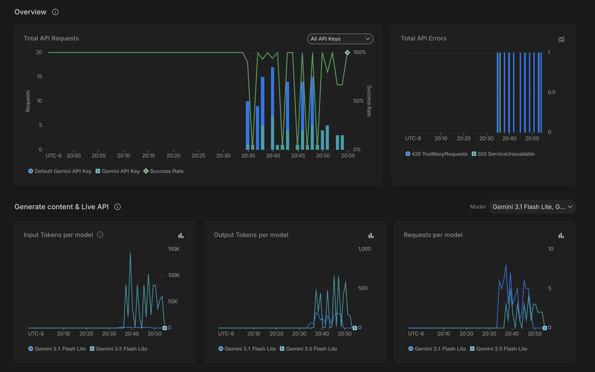

# AI Optimizations 

1. Input Translation Outside the Model/Token Layer

Before anything reaches the model as tokens, it goes through a normalization layer that resolves entities, disambiguates references and turns loose text into a constrained intent schema. For example that covers airport and airline code resolution (example:Booking.com) locale and language normalization into a fixed set of intents. All of that happens in the intermediate layer, not inside the prompt, so it costs zero model tokens. By the time the model sees anything, it's already a clean, resolved payload not raw customer text it has to guess at.

2. Token, Context and Cache Management - AI don't need to be sent in full on every single message

System prompts and tool schemas get hashed and registered against a cached content object with a time-to-live, so repeated calls inside that window reuse the cached version instead of resending the whole instruction set every single turn. Hits and misses are tracked separately, and there's a fallback to sending everything inline if a model or context falls below the Gemini -as the provider minimum cacheable size. The result is lower input token cost and faster response times after the first turn, since the static part of the prompt isn't being reprocessed from scratch every time. This follows the caching approach both Anthropic and Google Cloud document, referenced below.  
Cached reads run at roughly 10% of the normal input token rate; cache writes cost roughly 1.25x. 
Time-to-live: 55 minutes (3,300 seconds), auto-refreshed once the entry is within 60 seconds of expiring. 
Minimum cache:  Google Gemini: 1,024 / 2,048 tiers depending on model. Below this, the cache annotation is silently ignored.

3. Compression- don't feed the AI everything a data source sends back

Conversation history and tool results go through compression before the next model call. Instead of dumping raw API responses (flight results, hotel inventory, place details) straight into context, I strip it down to the fields the current request actually needs, cut redundant metadata and summarize older turns once they age out of the working window. That keeps context length low and predictable no matter how long the session runs, which lines up with the research on long-context degradation cited below and keeps cost from quietly climbing as a conversation gets longer.
History /Age: Anything older than 16 entries back has its raw tool-result payload (the full flights/hotels/activities JSON) replaced with a short marker naming the tool that ran. The turn itself (what was asked, what was said) is never deleted, only the bulky payload inside older tool-result turns.

4. Hallucination Minimization – Measuring vs describing

You don't fix hallucination by telling a model to be more careful. The research on why it happens (Ji et al., cited below) makes the mechanism pretty clear: a language model is trained to produce fluent, plausible text, and fluency isn't the same thing as being correct. Left unconstrained at the point of generation, a model will produce a wrong answer with exactly the same confident tone as a right one. Telling it to double check itself helps a little at the margins, but it doesn't touch the actual mechanism that produces the error. What has to change is what the model is allowed to generate and what it's generating from, not just what it's told to do. Three things do that work here and they need each other. 
First, anything factual about inventory, price or availability comes from a live provider call, injected as grounding context right before the response gets generated, not pulled from the model's own training. That's the retrieval-augmented generation approach from Lewis et al., cited below and it removes the single biggest cause of hallucination, which is a model answering a factual question from memory it doesn't actually have. It doesn't make hallucination impossible on its own though, because a model can still misread or embellish correct grounding data. 
Second, tool calls are schema-constrained, so a field like price or availability can only ever come from a declared function schema the code actually validated, never from a sentence the model wrote around the grounding data. That closes off a specific failure mode: a model that got the right data but still narrates a made-up number somewhere in its reply, outside the part that was actually checked. 
Third, since grounding and schema constraints reduce hallucination without ever getting it to zero, a rejection and escalation tracker watches for repeated low-confidence or out-of-scope replies and hands the conversation to a person instead of letting the model keep guessing once it's out of real data to work with. 
All three of these are measurable in the running system right now. How often a factual claim gets made without a grounding call behind it. How often the rejection tracker actually fires. How often the escalation path actually triggers.

5. Template Structure and Output Token Efficiency

Output token count mostly comes down through templating, not by telling the model to keep it short. When a reply matches a known intent, like a booking confirmation, it gets generated against a fixed template with defined slots, so the model only fills in the variable parts and the rest of the structure never gets regenerated as free text. Open-ended generation, where the model writes full prose from nothing, scales its token count with however much the model feels like saying. Slot-based templates keep that number bounded and predictable per intent.

6. Skill-Level Optimization

Requests get routed to a narrow, purpose-built handler instead of one giant prompt trying to cover every capability at once. Each skill only carries the tool declarations and instructions for its own domain, so the active context stays small on any given turn, and tool schemas that have nothing to do with the current request never get loaded. Routing happens before the model call, based on classified intent.

7. Verbose Text Over Images

Images and key data points can convey information more effectively than lengthy descriptions, the system prioritizes visual elements and concise metrics. Visuals enable faster comprehension, improve engagement, and make patterns easier to identify at a glance. Data points are also easier to compare, validate and act upon than large blocks of text. This approach reduces cognitive load and helps users reach insights more quickly while still providing supporting text when additional context is needed.

8. Model Substrate as a Tested Variable

Every strategy above assumes there's a well-behaved model underneath all of it and that's an assumption worth actually testing rather than taking on faith. The checks that matter: does the model still call the right function with the right argument types as the number of tools grows, or does accuracy start slipping. Does it keep following a rule stated once near the top of a long, cached prompt, or does recency bias pull it toward whatever was said more recently. And given the exact same grounded context, how often does it still assert something the grounding data doesn't actually support. These are things you can measure and reproduce, not a brand claim and they should be run against whatever model actually sits underneath any platform being evaluated, whether that model is disclosed up front or not.
